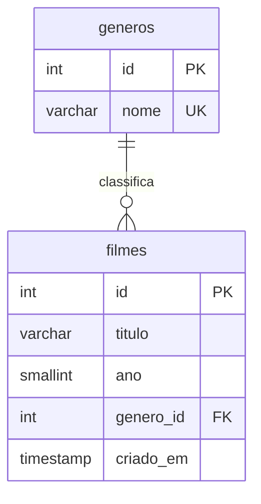

# Letterbox 🎬

Catálogo pessoal de filmes com **CRUD completo**: cadastrar, listar, buscar, editar e remover filmes, cada um ligado a um gênero. Projeto acadêmico de Banco de Dados feito com **HTML/CSS/JavaScript**, **Node.js (Express)** e **MySQL**.

## Sumário

- [Tecnologias](#tecnologias)
- [Estrutura do projeto](#estrutura-do-projeto)
- [Como executar](#como-executar)
- [Banco de dados](#banco-de-dados)
- [API](#api)
- [Regras de negócio](#regras-de-negócio)
- [Frontend](#frontend)
- [Problemas comuns](#problemas-comuns)
- [Limitações e próximos passos](#limitações-e-próximos-passos)

## Tecnologias

| Camada | Tecnologia |
| --- | --- |
| Frontend | HTML, CSS e JavaScript puro (sem framework) |
| Backend | Node.js + Express 4 |
| Banco de dados | MySQL (driver `mysql2` com pool de conexões) |
| Configuração | `dotenv` (arquivo `.env`) |
| Desenvolvimento | `nodemon` |

## Estrutura do projeto

```
letterbox-completo/
├── backend/
│   ├── database.js      # pool de conexões com o MySQL
│   └── server.js        # rotas da API, validações e servidor do frontend
├── database/
│   └── letterbox.sql    # criação do banco, tabelas e gêneros iniciais
├── frontend/
│   ├── index.html       # página e formulário (modal)
│   ├── css/style.css    # estilos responsivos
│   └── js/app.js        # chamadas à API e montagem da tela
├── .env.example         # modelo de configuração
├── package.json
└── README.md
```

### Arquitetura

```
Navegador (index.html + app.js)
        │  fetch (JSON)
        ▼
Express (server.js)  ──  valida os dados e monta o SQL
        │  mysql2 (consultas com ?)
        ▼
MySQL (tabelas generos e filmes)
```

O Express também serve a pasta `frontend/`. Por isso a página e a API ficam na **mesma origem** (`http://localhost:3000`) e não é preciso configurar CORS no uso normal.

## Como executar

### Requisitos

- [Node.js](https://nodejs.org/) instalado
- MySQL 8.0.16+ ou MariaDB 10.2+ iniciado (XAMPP, WAMP ou MySQL Server)

### Passo a passo

1. Extraia o projeto e abra a pasta `letterbox-completo` no VS Code.
2. Inicie o MySQL.
3. Abra o phpMyAdmin (`http://localhost/phpmyadmin`), vá na aba **SQL** e execute todo o conteúdo de `database/letterbox.sql`.
4. Na raiz do projeto, copie `.env.example` para `.env` e ajuste usuário e senha. No XAMPP padrão: `root` e senha vazia.

   ```env
   PORT=3000
   DB_HOST=localhost
   DB_PORT=3306
   DB_USER=root
   DB_PASSWORD=
   DB_NAME=letterbox
   ```

5. No terminal, na raiz do projeto:

   ```bash
   npm install
   npm run dev
   ```

6. Acesse **http://localhost:3000**.

Para rodar sem recarregamento automático, use `npm start`.

### Testes rápidos

| URL | O que deve acontecer |
| --- | --- |
| http://localhost:3000/api/health | `{"status":"ok","banco":"letterbox"}` |
| http://localhost:3000/generos | lista com os gêneros iniciais |
| http://localhost:3000/filmes | `[]` se ainda não houver filmes |

> **Já tinha uma versão anterior do banco?** Se a tabela `filmes` foi criada antes de existir a coluna `genero_id`, execute `DROP TABLE filmes;` no banco `letterbox` e depois rode o `letterbox.sql` de novo. Isso apaga os filmes cadastrados.

## Banco de dados

Banco `letterbox`, com `utf8mb4` e `utf8mb4_unicode_ci` (aceita acentos e caracteres especiais).



Relacionamento **1:N**: um gênero tem vários filmes, e cada filme tem no máximo um gênero (o campo é opcional).

### Tabela `generos`

| Coluna | Tipo | Restrição |
| --- | --- | --- |
| `id` | `INT AUTO_INCREMENT` | chave primária |
| `nome` | `VARCHAR(50)` | `NOT NULL`, `UNIQUE` |

Gêneros iniciais: Ação, Comédia, Drama, Ficção científica, Terror e Animação.

### Tabela `filmes`

| Coluna | Tipo | Restrição |
| --- | --- | --- |
| `id` | `INT AUTO_INCREMENT` | chave primária |
| `titulo` | `VARCHAR(150)` | `NOT NULL` |
| `ano` | `SMALLINT` | `NULL` (opcional) |
| `genero_id` | `INT` | `NULL`; chave estrangeira para `generos(id)` |
| `criado_em` | `TIMESTAMP` | `DEFAULT CURRENT_TIMESTAMP` |

### Regras de integridade no banco

| Restrição | Efeito |
| --- | --- |
| `CHECK (ano IS NULL OR ano BETWEEN 1888 AND 2100)` | o banco recusa anos fora do intervalo |
| `UNIQUE (titulo, ano)` | impede o mesmo título e ano duas vezes |
| `FOREIGN KEY (genero_id) REFERENCES generos (id)` | o gênero informado precisa existir |
| `ON DELETE SET NULL` | se um gênero for apagado, os filmes ficam sem gênero |
| `ON UPDATE CASCADE` | se o `id` do gênero mudar, os filmes acompanham |
| `INDEX idx_filmes_genero` | acelera a junção com `generos` |

> No `UNIQUE (titulo, ano)`, o valor `NULL` conta como diferente de qualquer outro. Por isso, dois filmes com o mesmo título e **sem ano** são aceitos.

## API

Todas as rotas respondem em JSON. Em caso de erro, o corpo é `{ "erro": "mensagem" }`.

| Método | Rota | Função | Respostas |
| --- | --- | --- | --- |
| `GET` | `/api/health` | testa a API e a conexão com o MySQL | 200, 500 |
| `GET` | `/generos` | lista os gêneros (ordem alfabética) | 200 |
| `GET` | `/filmes` | lista os filmes, do mais recente ao mais antigo | 200 |
| `GET` | `/filmes?busca=texto` | filtra por título (`LIKE`) | 200 |
| `GET` | `/filmes/:id` | busca um filme | 200, 400, 404 |
| `POST` | `/filmes` | cadastra um filme | 201, 400, 409 |
| `PUT` | `/filmes/:id` | atualiza um filme | 200, 400, 404, 409 |
| `DELETE` | `/filmes/:id` | remove um filme | 200, 400, 404 |

### Corpo de `POST` e `PUT`

```json
{
  "titulo": "Interestelar",
  "ano": 2014,
  "genero_id": 4
}
```

`ano` e `genero_id` são opcionais e aceitam `null` ou texto vazio.

### Exemplo de resposta de `GET /filmes`

```json
[
  {
    "id": 1,
    "titulo": "Interestelar",
    "ano": 2014,
    "genero_id": 4,
    "genero": "Ficção científica",
    "criado_em": "2026-11-01T23:15:46.000Z"
  }
]
```

### Consultas SQL principais

```sql
-- Listagem com busca (LEFT JOIN mantém filmes sem gênero)
SELECT f.id, f.titulo, f.ano, f.genero_id, g.nome AS genero, f.criado_em
FROM filmes f
LEFT JOIN generos g ON g.id = f.genero_id
WHERE f.titulo LIKE ?
ORDER BY f.id DESC;

-- Cadastro
INSERT INTO filmes (titulo, ano, genero_id) VALUES (?, ?, ?);

-- Edição
UPDATE filmes SET titulo = ?, ano = ?, genero_id = ? WHERE id = ?;

-- Exclusão
DELETE FROM filmes WHERE id = ?;
```

Todas as consultas usam parâmetros (`?`), o que evita SQL injection. Na busca, os caracteres `%` e `_` digitados pelo usuário são escapados.

## Regras de negócio

| Regra | Comportamento |
| --- | --- |
| Título obrigatório | precisa ser texto, não vazio (após `trim()`) e ter no máximo 150 caracteres; senão, **400** |
| Ano opcional | vazio vira `NULL`; a tela mostra "Ano não informado" |
| Ano válido | número inteiro entre 1888 e 2100; senão, **400** |
| Gênero opcional | vazio vira `NULL`; se informado, precisa ser um ID positivo que exista em `generos`; senão, **400** |
| Sem filmes repetidos | mesmo título e ano violam o `UNIQUE`; a API responde **409** |
| ID válido | em consulta, edição e exclusão, o ID deve ser inteiro positivo; senão, **400** |
| Filme inexistente | consulta, edição ou exclusão de um ID que não existe respondem **404** |

A validação acontece em **duas camadas**: no formulário e no servidor (função `validarFilme`, usada pelo `POST` e pelo `PUT`). O banco ainda reforça as regras com `CHECK`, `UNIQUE` e `FOREIGN KEY`, protegendo os dados mesmo que alguém use a API diretamente.

## Frontend

O arquivo `frontend/js/app.js` concentra a lógica:

| Função | O que faz |
| --- | --- |
| `loadFilms()` | busca `GET /filmes?busca=...`; o filtro é feito no MySQL, com atraso de 250 ms ao digitar |
| `loadGenres()` | busca `GET /generos` e preenche o seletor do formulário |
| `renderFilms()` | monta os cards com `textContent` (evita XSS) e mostra o gênero |
| `openDialog(film)` | abre o formulário vazio (novo filme) ou preenchido (edição) |
| `saveFilm()` | envia `POST` se for novo ou `PUT` se estiver editando |
| `deleteFilm(id)` | pede confirmação, envia `DELETE` e recarrega a lista |

## Problemas comuns

**`Access to fetch at 'file:///...' has been blocked by CORS policy`**
O HTML foi aberto direto do disco (`file://`). Acesse sempre por **http://localhost:3000**, com o servidor rodando (`npm run dev`).

**Página abre, mas mostra "Não foi possível conectar à API"**
O backend não está rodando ou o MySQL está parado. Teste `http://localhost:3000/api/health`.

**`/api/health` retorna erro**
Confira `DB_USER`, `DB_PASSWORD` e `DB_NAME` no `.env` e se o `letterbox.sql` foi executado.

**Erro 500 ao listar ou cadastrar filmes**
Provavelmente a tabela `filmes` é da versão antiga (sem `genero_id`). Veja o aviso na seção [Como executar](#como-executar).

**Usando o Live Server do VS Code**
Funciona: o `app.js` aponta para `http://localhost:3000` quando a página não está na porta 3000, e o backend envia os cabeçalhos CORS. O backend continua precisando estar rodando.

## Limitações e próximos passos

- Projeto de uso **local**: não há autenticação nem HTTPS, e o CORS está aberto (`*`) para facilitar o desenvolvimento. Antes de publicar, restrinja a origem permitida.
- Não há paginação; a listagem traz todos os filmes.
- Ideias de evolução: diretores e avaliações (tabelas N:N), paginação, índice `FULLTEXT` na busca por título e autenticação de usuários.
- **Não envie o seu `.env` para o GitHub.** O `.gitignore` já o exclui.
